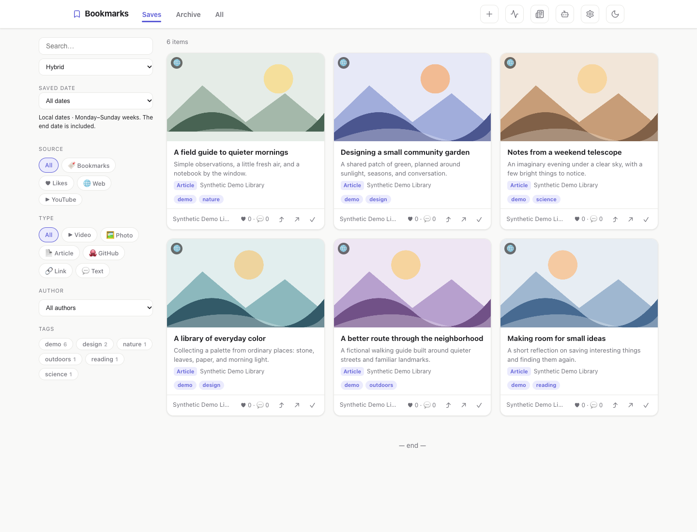
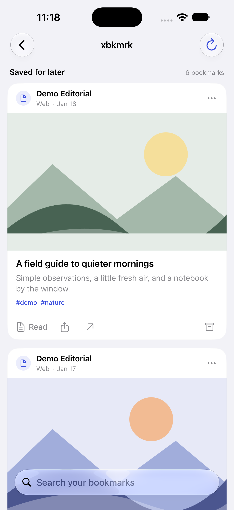
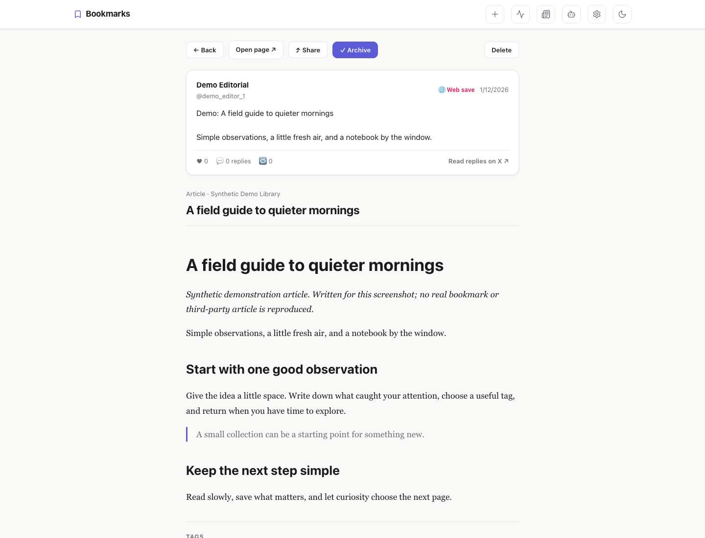
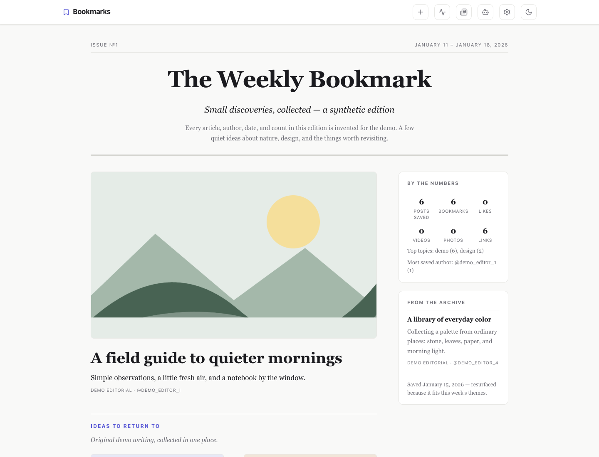
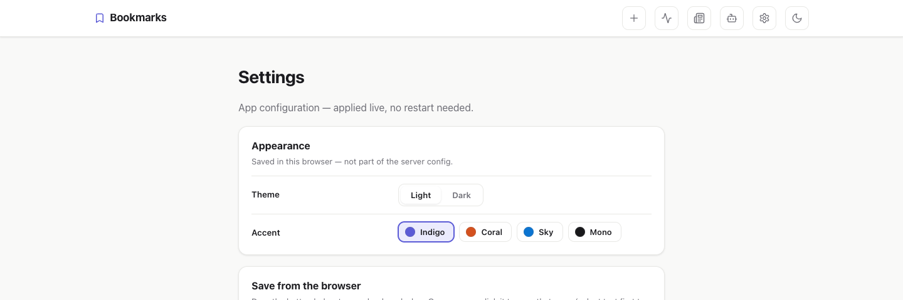
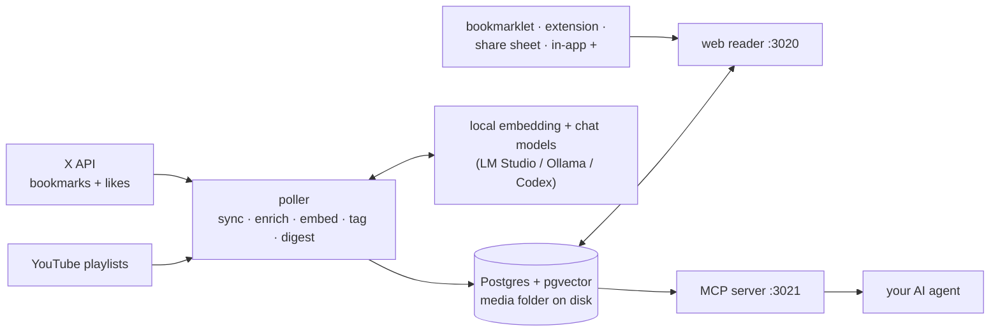

# X Bookmark Archive

**A self-hosted archive for everything you save — X bookmarks, web pages, YouTube
playlists — searchable, readable, and AI-ready.**

It started with X bookmarks, where posts go to be forgotten: no search worth the name, no
notes, and they vanish when a post is deleted. This tool syncs them (and optionally your
likes) into your own Postgres — but anything can land in the same archive: share a link
from your phone, click a bookmarklet, paste a URL into the app, or point it at a YouTube
playlist. Media is downloaded, linked articles extracted, everything embedded for semantic
search — with a clean reading app plus an MCP server so your AI agents can search
everything you've saved.



Screenshots use invented content and original geometric artwork. See [asset provenance](docs/ASSET_PROVENANCE.md) and [capture instructions](docs/demo/README.md).

## What you get

- **Pocket-style reader** — card grid with tabs for *Saves / Archive / All*, filters by
  source (bookmarks/likes/web/YouTube), type (video, photo, article, GitHub repo, link,
  text post), author, and tag.
- **YouTube playlists as a source** — point Settings → Sources at any public or unlisted
  playlist (no API key) and every video becomes a bookmark, with an inline player in the
  reading view; new videos are picked up on each sync check.
- **Save from anywhere** — paste a link straight into the app (the **+** button), click
  the bookmarklet, use the browser extension, or share from the iOS share sheet. Shared X
  posts are hydrated for free — author, text, photos/video, metrics — without touching
  the paid API; reddit links pull in the post and its top comments.
- **Real search** — keyword, semantic (pgvector embeddings), or hybrid.
- **Full reading view** — the post with its media, plus the **extracted article** for external
  links or the **README** for GitHub repos. Add your own notes and tags.
- **Auto-tagging** — an LLM tags each post as it's synced (local LM Studio/Ollama model, or
  the Codex CLI via `LLM_PROVIDER=codex` — see `docker-compose.override.example.yml`).
- **The Weekly Bookmark** — a newspaper-style front page of your week's bookmarks, printed
  on a schedule with LLM-written blurbs and an editor's note; liked posts get their own
  sidebar box.
- **MCP server** — read-only endpoint so Claude (or any MCP client) can search and
  recommend from your archive.
- **Password-protected** — the whole site sits behind a single password (set on first visit)
  with long-lived sessions, safe to expose beyond your LAN (e.g. Tailscale Funnel). Save
  routes keep their own token, so the bookmarklet, extension, and iOS shortcut still work;
  the MCP server requires a bearer token (shown on the Connect page).
- **Your data stays yours** — everything lives in a local Postgres + a media folder you can
  back up.

## iPhone and iPad app

The native SwiftUI companion lives in [`ios/`](ios/README.md), alongside the server.
Open `ios/XBkmrk.xcodeproj` in Xcode, select your signing team, and run the
`XBkmrk` scheme. It supports iOS 26 and later and connects to your own server URL
and website password. See the [iOS setup and build guide](ios/README.md).



Saved-date filters in the web and iOS sidebars offer Today, Yesterday, This week,
Last week, and an inclusive custom range. Deploy this server version alongside
the app to support the saved-date API.

## Every way in

| Intake | What you do | What lands in the archive | Needs |
|---|---|---|---|
| **X sync** | bookmark or like posts on X, as always | post + downloaded media, quoted posts, author, metrics, long-form X Articles | X developer app (free tier) |
| **Bookmarklet / browser extension** | one click on any page | the page — title, extracted article, thumbnail; selected text becomes a note | nothing extra |
| **iOS share sheet** | Share → your shortcut, from any app | same | nothing extra |
| **In-app** | the **+** button in the header — paste any URL | same | nothing extra |
| **YouTube playlists** | add a playlist URL in Settings → Sources | every video with its transcript and an inline player; new videos picked up on each sync | nothing extra (API key optional) |

Whichever door a bookmark comes through, it gets the same pipeline afterwards: media
download, article/README/reddit-thread extraction, embedding for semantic search, and
auto-tagging. Web-saved X post links are hydrated for free via X's embed endpoints — no
API credits.

### Reading view

Posts render with media and quoted posts; external links get the full article text, GitHub
links get the repo README (with images resolved):



### The Weekly Bookmark

Every Friday afternoon (configurable), the poller lays out a front page from the week's
bookmarks — lead story by engagement, sections by tag, a "liked this week" list, and a
"from the archive" pick chosen by vector similarity to the week's themes:



### Settings

App configuration lives in the database and is editable in the browser — changes apply live,
no restarts. Theme and accent color (indigo, coral, sky, mono × light/dark) are picked here
too:



## How it works



| Service | What | Port (host) |
|---|---|---|
| `db` | `pgvector/pgvector:pg17`, dedicated container | `127.0.0.1:5433` (inspection only) |
| `poller` | Syncs on a cron schedule, downloads media, embeds, auto-tags, prints the digest | — |
| `web` | Next.js reader | `3020` |
| `mcp` | MCP server (Streamable HTTP, `/mcp`) with a read-only DB role | `3021` |

Ports are configurable in `.env` (`WEB_PORT`, `MCP_PORT`, `DB_INSPECT_PORT`).

For the full picture — every intake path, what each processing stage extracts and stores,
and exactly what is sent to the AI models — see [docs/data-flow.md](docs/data-flow.md).

## Quick start

What you need, and what each piece unlocks:

| | Needed for | Notes |
|---|---|---|
| **Docker** (with Compose) | everything | the only hard requirement on the host |
| **X developer app** (optional) | the X sync source | free tier works; billed per post read, steady-state cost near zero (see [API cost](#about-api-cost)). Skip it and the app still archives web saves and YouTube — add the credentials later in Settings |
| **Embedding endpoint** | semantic & hybrid search, digest archive picks | any OpenAI-compatible `/v1/embeddings` — LM Studio or Ollama running `nomic-embed-text` on the same box is perfect. Without it, keyword search still works |
| **Chat model** (optional) | auto-tagging, digest blurbs | same LM Studio/Ollama host, or Codex CLI |
| **`GITHUB_TOKEN`** (optional) | README enrichment above 60 req/h | plain personal token, no scopes needed |
| **Reddit script app** (optional) | post + top-comments enrichment for reddit links | free, created in [reddit.com/prefs/apps](https://www.reddit.com/prefs/apps); without it reddit links mostly fail (anonymous scraping is blocked) |

### 1. Configure

```bash
cp .env.example .env
# fill in: DB_PASSWORD, EMBEDDING_API_URL
# (X_CLIENT_ID / X_CLIENT_SECRET too if you're setting up the X source now — see below)
```

`EMBEDDING_API_URL` must be reachable **from inside containers** — use
`host.docker.internal` for a server on the same machine or a LAN/Tailscale IP, never plain
`localhost`. That also means the server must listen on the network, not just loopback:
in LM Studio enable **Serve on Local Network**; for Ollama set `OLLAMA_HOST=0.0.0.0`.
`EMBEDDING_DIM` must match the model (768 for `nomic-embed-text`) **and** the
`vector(768)` column in `db/migrations/0001_init.sql`.

### 2. Start the DB and migrate

```bash
docker compose up -d db
docker compose run --rm --build poller npm run migrate
```

### 3. Run everything

```bash
./restart.sh                    # docker compose up -d
docker compose logs -f poller
```

- Web reader: `http://<host>:3020`
- MCP endpoint: `http://<host>:3021/mcp`

### 4. First visit

Open the web reader — it asks you to **set the site password** (one password for the whole
app, sessions last ~180 days), then drops you on a **setup checklist** (`/welcome`, come
back to it any time) that tracks the remaining steps live: connecting the embedding model,
adding the X source, grabbing the save tools (bookmarklet, browser extension, iOS
shortcut), YouTube playlists, and hooking up an AI agent. Everything it links to lives in
Settings — which is DB-backed, so changes apply live with no restarts.

The MCP server requires a bearer token (minted on the `/connect` page). Since everything
is authenticated, exposing the app beyond your LAN via Cloudflare Tunnel / Tailscale is
fine — but there's no rate limiting or brute-force protection, so prefer a private tunnel
over opening the ports to the public internet.

At this point you have a working archive for web saves and YouTube. To sync your X
bookmarks too:

### 5. Add the X source

1. Go to <https://developer.x.com> → create a project + app (bookmark reads are billed as
   Owned Reads, ~$0.001/bookmark with 24h dedup — steady-state cost is near zero, see below).
2. In **User authentication settings**, enable **OAuth 2.0**:
   - Type of app: **Web App** (confidential client) — gives you a client secret.
   - Callback URI: `http://localhost:3022/callback`
   - Scopes used: `tweet.read users.read bookmark.read like.read offline.access`
3. Put the **Client ID** and **Client Secret** in `.env` (or Settings → X API), then log
   in once:

```bash
docker compose run --rm -p 3022:3022 poller npm run auth
```

Open the printed URL and authorize. If your browser runs on the same machine (or via
`ssh -L 3022:localhost:3022 <server>`), the redirect is caught automatically; otherwise
paste the redirect URL from the address bar back into the terminal.

The refresh token is stored in the `oauth_token` table (it **rotates** on every refresh,
so it lives in the DB, never in `.env`). The next sync — scheduled, on app open, or "Sync
now" in the header — backfills your bookmarks; watch it with
`docker compose logs -f poller`.

### About API cost

The poller pages newest-first and **stops at the first already-seen post**, so after the
initial backfill each sync run costs a handful of reads. Manual sync any time with the
status menu in the header (or `docker compose run --rm poller npm run sync`).

## Link enrichment

After every sync the poller enriches each bookmark's first external link (new bookmarks plus
a backfill of 25 older ones per run):

- og metadata (title, description, image — downloaded to `data/media/og/`)
- readable article HTML via Readability (sanitized at ingest)
- GitHub repos: README markdown + repo metadata via the GitHub API
  (set `GITHUB_TOKEN` in `.env` to lift the 60 req/h unauthenticated limit)
- X posts saved via the bookmarklet / share sheet: hydrated from X's free embed
  endpoints (author, text, photos/video, metrics — no API credits), then the post's own
  link gets the treatment above
- Reddit posts (with free script-app credentials — `REDDIT_CLIENT_ID`/`SECRET` in `.env`
  or Settings): post body, preview image (video too for direct saves), and the top
  comments, rendered like a README in the reading view

Failures are recorded and skipped — they never block a sync.

## Connecting an AI agent (MCP)

```bash
claude mcp add --transport http x-bookmarks http://<host>:3021/mcp
```

Four tools, served by a read-only DB role (`bookmarks_ro`):

| Tool | What it does |
|---|---|
| `search_bookmarks(query, limit)` | hybrid keyword + vector search |
| `get_unread(limit)` | unread bookmarks, newest saved first |
| `recommend(context, limit)` | semantic similarity to a context string |
| `get_bookmark(id)` | full record incl. notes, tags, media paths |

The web app's `/connect` page has copy-paste setup snippets for common clients.

## Operations

- `./restart.sh` — bounce the stack
- `./update.sh` — pull main, run migrations, rebuild + restart
- Back up `data/` (media) and the `xbm_pgdata` volume (Postgres).
- Migrations: add `db/migrations/NNNN_name.sql`; applied in filename order, tracked in
  `schema_migrations`, idempotent to re-run.
- If the embedding endpoint is down, ingestion still proceeds; missing embeddings are
  backfilled on the next sync.
- One-off backfills: `npm run backfill:articles | backfill:banners | backfill:tags`
  (via `docker compose run --rm poller …`).

## Troubleshooting

| Symptom | Cause / fix |
|---|---|
| Semantic search finds nothing; poller logs `embed: fetch failed` or timeouts | The embedding endpoint isn't reachable **from inside the container**. Use `host.docker.internal` (or a LAN IP), and make the server listen beyond loopback: LM Studio → *Serve on Local Network*, Ollama → `OLLAMA_HOST=0.0.0.0`. |
| Poller logs `embed: got N dims, expected 768` | `EMBEDDING_DIM` doesn't match the model. Change the model, or change both `EMBEDDING_DIM` and the `vector(768)` column in `db/migrations/0001_init.sql` (before first migrate). |
| Poller logs `sync failed: … Missing required setting: X_CLIENT_ID` | Expected until you set up the X source (Quick start step 5) — web saves and YouTube keep working; the message is harmless. |
| X sync fails with `402` (credits depleted) | You've used the month's API credits. Leave `SYNC_CRON` empty so syncs only happen when you open the app (`SYNC_ON_ACCESS_HOURS`), and let the cycle reset. The rest of the app keeps working. |
| `npm run auth` prints a URL but the redirect page never loads | Normal on a headless server: authorize in any browser, then paste the resulting `localhost:3022/callback?...` URL from the address bar back into the terminal (or forward the port first: `ssh -L 3022:localhost:3022 <server>`). |
| Port already in use | Change `WEB_PORT` / `MCP_PORT` / `DB_INSPECT_PORT` in `.env` and `docker compose up -d`. |
| Bookmarks appear without tags | Auto-tagging needs a chat model (`TAGGING_MODEL` on the embedding host, or `LLM_PROVIDER=codex`). Untagged posts are retried on every sync once one is configured. |
| Unlisted YouTube playlist imports fewer videos than expected | The keyless path scrapes ~100 newest videos and dates them by import time. Add a `YOUTUBE_API_KEY` in Settings → Sources for full pagination and real added-on dates. |

## Out of scope (for now)

Reply/comment thread capture, near-duplicate dedup, re-embedding jobs, multi-user.

## License

[MIT](LICENSE)
