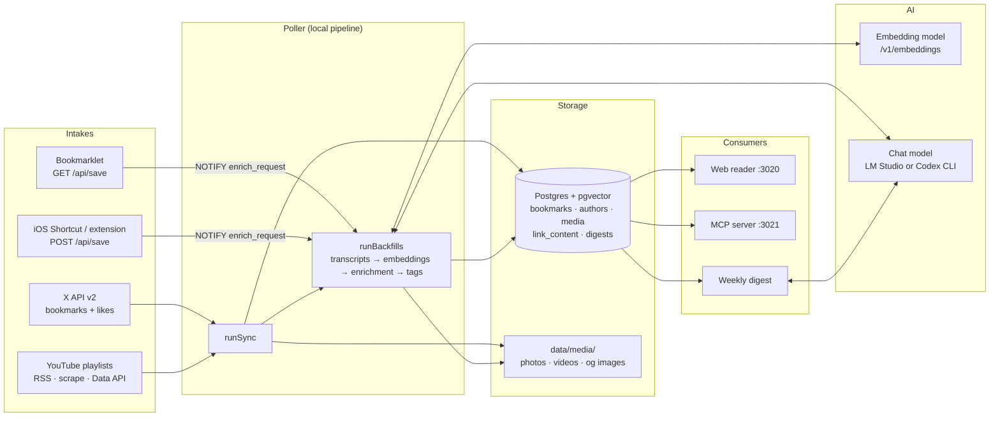
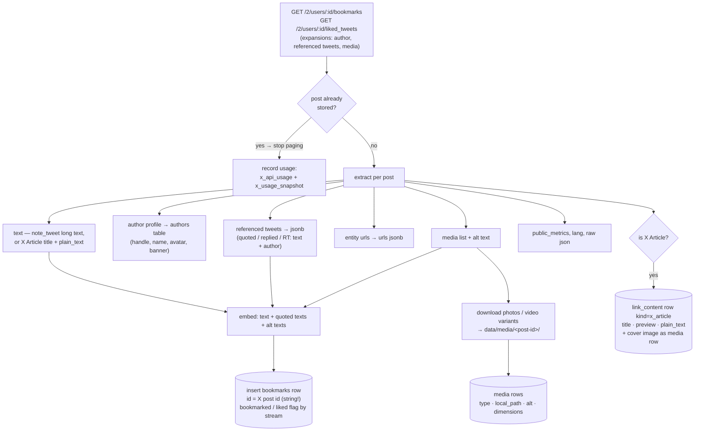
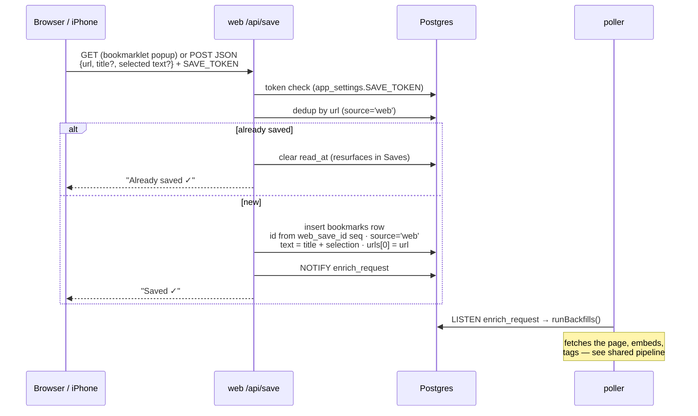
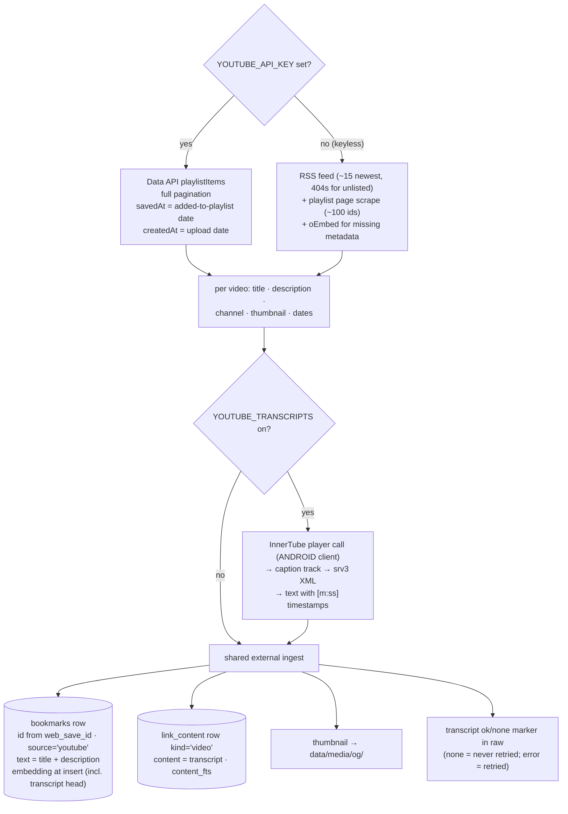
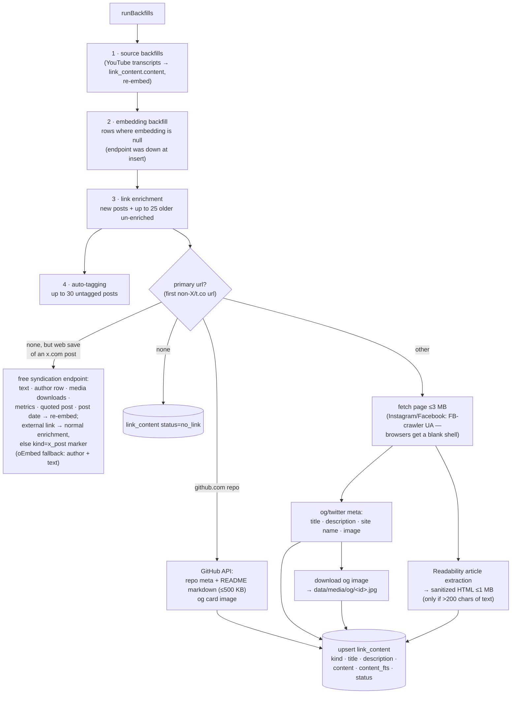
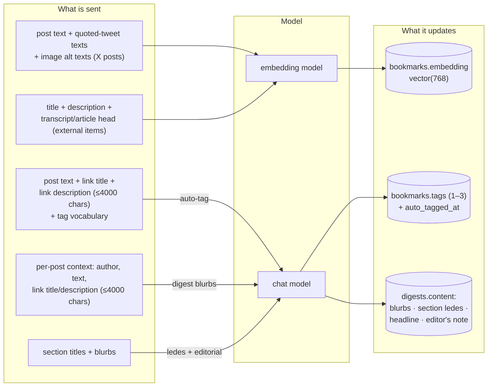
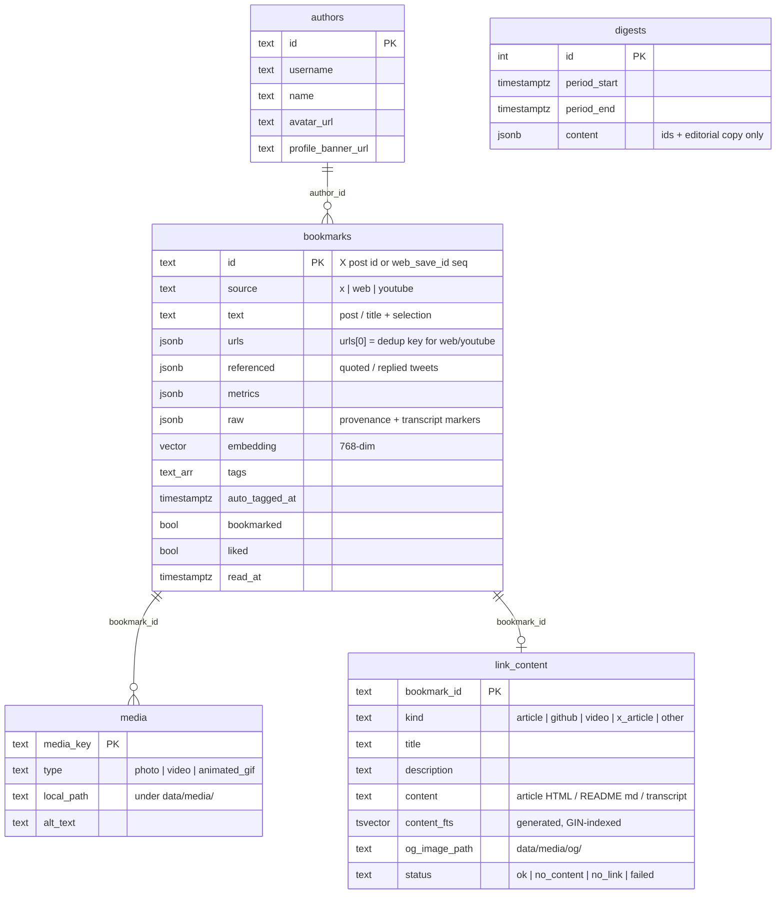

# Data flow: intakes, processing, storage, and AI

How a bookmark gets into the archive, what happens to it on the way in, what ends up
stored, and exactly what is sent to an LLM (and what it writes back).

## The big picture

Four intake paths feed one shared pipeline. Everything converges on the same tables, and
every row — regardless of origin — gets the same downstream treatment: embedding,
link enrichment, and auto-tagging.

Sync triggers: `SYNC_CRON` (optional), opening the web app when the last sync is older
than `SYNC_ON_ACCESS_HOURS` (`NOTIFY sync_request`), the header's Sync now button, and
poller boot when overdue.

---

## Intake 1 — X bookmarks & likes (X API)

The poller pages each stream newest-first and **stops at the first already-seen post**
(X bills per post read, so this is the cost control). First page asks for 25 posts,
deeper pages 100. The likes stream additionally stops at posts older than
`LIKES_MAX_AGE_DAYS`.

What is **not** fetched here: linked-page content, tags, transcripts — those all come
from the shared backfill pipeline after the stream sync.

## Intake 2 — Web saves (bookmarklet, iOS Shortcut, browser extension)

This path **records intent only** — no page is fetched by the web app. The poller's
pipeline does the fetching moments later.

Extracted at intake: URL, page title (≤500 chars), selected text (≤2000 chars),
`saved_via` provenance in `raw`. Everything else (article content, og image,
description, embedding, tags) arrives via the shared pipeline.

Sharing an **X post** this way is a special case: x.com can't be scraped, so the
pipeline hydrates the bookmark from X's free syndication endpoint (the JSON behind
embedded-tweet widgets — no API credits). That rebuilds the bookmark as if it had
arrived via the API sync: real post text, an `authors` row (avatar, handle), post
date, like/reply counts, the quoted post, and **downloaded media** (full-size photos,
best-bitrate mp4). If the post links out, that link then goes through the normal
enrichment (article / GitHub README / og image); otherwise a `kind='x_post'` marker
row identifies it to the UI, which shows an "Open on X" button and a "Saved from X"
badge. When syndication fails, an oEmbed fallback still recovers author + text.
Long posts may be truncated to the classic preview length — full note text needs the
paid API.

## Intake 3 — YouTube playlists

Configured in Settings → Sources (`YOUTUBE_PLAYLISTS`). Runs at the **start** of every
sync (an X API failure never blocks it) and immediately when the playlist settings
change.

A transcript **backfill** pass (part of `runBackfills`) later fetches transcripts for
videos ingested before the feature existed or that failed transiently, then re-embeds
the bookmark with the transcript folded in. If an API key is added after a keyless
import, dates are silently corrected (`backdateExternalItem`).

---

## Shared processing pipeline (`runBackfills`)

Runs after every sync and whenever a web save NOTIFYs `enrich_request`. Local HTTP
only — never touches the X API. Order matters: transcripts update content that
embeddings and tags build on.

Enrichment failures are recorded (`status=failed`) and never retried; they never block
a sync. Embedding failures leave `embedding` null and are retried next run.

---

## What gets sent to AI — and what it updates

Two model roles, both configurable in Settings → AI:

- **Embedding model** — OpenAI-compatible `/v1/embeddings` (LM Studio / Ollama,
  `nomic-embed-text` by default). Input truncated to 8000 chars.
- **Chat model** — either the same LM Studio host (`/v1/chat/completions`,
  `TAGGING_MODEL`) or the Codex CLI (`LLM_PROVIDER=codex`).

| AI task | Trigger | Exact input | Updates | Failure behavior |
|---|---|---|---|---|
| Embedding | at insert; backfill for nulls; re-embed after transcript | post text + quoted texts + alt texts, or title + description + content head (≤8000 chars) | `bookmarks.embedding` | null vector, retried next run — never blocks ingestion |
| Auto-tag | backfill, ≤30/run, only `tags='{}'` **and** never attempted | text + link title + link description (≤4000 chars), seed + DB tag vocabulary in the prompt | `bookmarks.tags` (1–3 normalized kebab-case tags), `auto_tagged_at` | left untagged, retried; manual tags are never touched |
| Digest blurbs | weekly `DIGEST_CRON` / on demand | per post: author, text, link title, link description (≤4000 chars) | `digests.content` (per-post summaries) | falls back to raw excerpts |
| Section ledes | during digest, sections with ≥3 items | section title + up to 8 blurbs (200 chars each) | `digests.content` sections | lede omitted |
| Editorial | during digest | lead blurb + section overview | `digests.content` headline + editor's note | both null, digest still publishes |

**Never sent to any model:** media files, raw API JSON, full article/README bodies for
tagging (title + description only), auth tokens. Everything sent goes to *your own*
endpoint (local LM Studio/Ollama or your Codex account) — there is no third-party AI
service baked in.

---

## Storage map

Supporting tables: `oauth_token` (rotating X refresh token — lives here, never in
`.env`), `sync_state`, `app_settings` (DB-backed settings incl. `SAVE_TOKEN`, auth
hash), `mcp_auth` (MCP bearer token), `digest_state` (live progress),
`x_api_usage` / `x_usage_snapshot` (cost meter). On disk: `data/media/<post-id>/`
(photos, videos) and `data/media/og/` (link thumbnails). Back up `data/` + the
`xbm_pgdata` volume.

## Who reads what

| Consumer | Reads | Notes |
|---|---|---|
| Web reader | everything via `bookmarks_ro`-equivalent queries | keyword search = FTS over text **and** `content_fts` (articles, READMEs, transcripts, weight 0.8); semantic = pgvector cosine; hybrid = both |
| MCP server (`:3021/mcp`) | read-only role `bookmarks_ro` | `search_bookmarks`, `get_unread`, `recommend`, `get_bookmark` (returns full content incl. transcripts); bearer-token authed |
| Weekly digest | week's posts + embeddings | lead by engagement, sections by tag, liked-only posts in a rail box, archive pick = pgvector nearest to the week's centroid |
